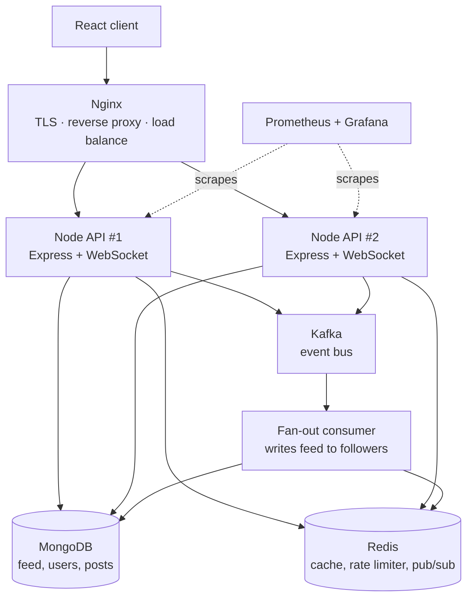

# Scalable Social Feed API

A MERN-stack social feed built to demonstrate distributed-systems design,
not just CRUD: hybrid fan-out (write-path for normal users, read-time
merge for high-follower accounts), Kafka-decoupled writes, Redis
cache-aside with graceful degradation, cursor-based pagination, and
real-time notifications that work correctly across horizontally scaled
instances.

## Architecture

React → Nginx (TLS, reverse proxy, load balancing) → 2× Node/Express
instances → MongoDB / Redis / Kafka, with a separate consumer service
handling asynchronous fan-out, and Prometheus/Grafana for observability.



## Local setup

1. Copy environment files:
   ```bash
   cp .env.example .env
   cp backend/.env.example backend/.env   # optional, for running outside Docker
   cp consumer/.env.example consumer/.env # optional, for running outside Docker
   ```
   Fill in a real `JWT_SECRET` in `.env` (a long random string).

2. Build the frontend once before first run — Nginx serves the static
   build directly, it doesn't build it for you:
   ```bash
   cd frontend && npm install && npm run build && cd ..
   ```

3. Bring the whole stack up:
   ```bash
   docker compose up --build
   ```

4. The app is served through Nginx. Check `docker compose ps` — all
   services (nginx, api-1, api-2, consumer, mongo, redis, kafka,
   zookeeper, prometheus, grafana) should be `Up`.

5. Grafana is on `localhost:3001` (default login `admin`/`admin` on
   first run), Prometheus on `localhost:9090`.

## Known local-dev limitation

Nginx is configured for TLS (`ssl_certificate` pointing at Certbot
paths) — it won't start locally without real certs at those paths.
For local development, either comment out the `listen 443 ssl` server
block and use `listen 80` only, or generate a throwaway self-signed
cert. The production `nginx.conf` as committed is meant for the real
deployment, not local HTTP testing.

## Deployment (Day 5)

1. **DNS first, before anything else** — propagation is the one step
   you can't rush. Register a free subdomain (DuckDNS, afraid.org) and
   point its A record at your VPS's IP. Do this and let it sit while
   you do everything else below.

2. **Provision the VPS** (tested against Ubuntu 22.04/24.04):
   ```bash
   scp -r deploy/ root@<vps-ip>:/root/
   ssh root@<vps-ip>
   cd /root/deploy
   DOMAIN=yourname.duckdns.org EMAIL=you@example.com ./vps-setup.sh
   ```
   This installs Docker, Certbot, configures `ufw`, and issues a TLS
   cert. It must run **before** anything is listening on port 80/443,
   since Certbot's standalone mode needs that port free.

3. **Clone the repo and configure secrets** on the VPS:
   ```bash
   git clone <your-repo-url> /opt/social-feed
   cd /opt/social-feed
   cp .env.example .env   # fill in real JWT_SECRET, etc.
   ```
   Edit `nginx.conf`, replacing `yourdomain.duckdns.org` with your real
   domain in both `server_name` lines.

4. **Install the renewal hook** so cert renewal actually reloads the
   Docker Nginx (Certbot doesn't know about it by default):
   ```bash
   cp deploy/renew-hook.sh /etc/letsencrypt/renewal-hooks/deploy/reload-nginx.sh
   chmod +x /etc/letsencrypt/renewal-hooks/deploy/reload-nginx.sh
   ```

5. **Bring it up** — note `-f docker-compose.yml` explicitly, so the
   local override file (which strips TLS) is never picked up here:
   ```bash
   docker compose -f docker-compose.yml up -d --build
   ```

6. **Add GitHub Actions secrets** (repo Settings → Secrets → Actions)
   so future pushes to `main` deploy automatically: `VPS_HOST`,
   `VPS_USER`, `VPS_SSH_KEY` (a deploy-only private key), and
   `VPS_DEPLOY_PATH` (`/opt/social-feed`).

## Load testing & chaos testing (Day 6)

All scripts live in `load-test/` and are meant to run against the live
VPS deployment, not localhost — the point is proving real behavior
under real network conditions.

1. **Install k6**: https://k6.io/docs/get-started/installation/
2. **Baseline (cold cache)**:
   ```bash
   k6 run -e BASE_URL=https://yourdomain.duckdns.org load-test/feed-load-test.js
   ```
3. **Re-run immediately (warm cache)** — same command again. Compare
   the two runs' p95/p99 in the summary output; that delta is the
   actual proof the Redis cache-aside layer does something.
4. **Load-balancing proof** (run during either load test, or standalone):
   ```bash
   ./load-test/prove-load-balancing.sh https://yourdomain.duckdns.org
   ```
5. **Chaos test** — start a fresh `k6 run` in one terminal, then in a
   second terminal on the VPS:
   ```bash
   ./load-test/chaos-redis.sh /opt/social-feed
   ```
   This kills Redis mid-load, waits, and restarts it, printing
   timestamps. Fill in `load-test/POSTMORTEM_TEMPLATE.md` with the
   actual before/during/after numbers from the k6 output and
   `docker compose logs` — this write-up matters more in an interview
   than the passing test itself.

## Design decisions

Each of these was a real trade-off, not a default — the reasoning is
what this project is actually meant to demonstrate.

### Hybrid fan-out (the central decision)

Fan-out-on-write (precompute every follower's feed at post time) makes
reads cheap but means a post from a high-follower account triggers
writes proportional to follower count. Fan-out-on-read (query at read
time) makes writes cheap but means every feed read re-queries and
merges posts from everyone followed, every time.

**Decision**: a 10,000-follower threshold. Below it, the consumer
batch-writes the post into every follower's `Feed` document (`consumer/src/fanout.js`).
At or above it, the write is skipped entirely and the author is marked
in a Redis set; the feed route (`backend/src/routes/feed.js`) merges
their posts in at read time instead. This is the same approach
Twitter/Instagram use for the "celebrity problem."

**Trade-off accepted**: a celebrity's followers pay a slightly more
expensive read (an extra query + in-memory merge) in exchange for not
making every one of their posts trigger a potentially massive write
storm.

### Cursor-based pagination, not skip/limit

`skip/limit` recalculates position by counting rows from the start.
With the fan-out consumer inserting new entries concurrently, that
means pages can skip or duplicate items between loads. Cursor
pagination anchors on `insertedAt < cursor`, so a page's contents stay
correct regardless of what's been inserted since the last page was
fetched.

**Trade-off accepted**: no "jump to page 5" — cursor pagination only
supports sequential paging, which is the right trade for a feed (no
one page-jumps a feed) but would be wrong for, say, an admin table.

### Cache-aside with fail-open, not fail-closed

The feed route and rate limiter both wrap Redis calls in try/catch and
fall through to MongoDB (or, for the limiter, allow the request) on
any Redis error, rather than returning an error to the user.

**Reasoning**: Redis here is a performance optimization, not a
correctness dependency — nothing about serving a feed or rate-limiting
a request is only possible with Redis. Treating it as a hard
dependency would mean a Redis blip takes down the whole API for a
component whose only job is making things faster.

**Trade-off accepted**: during a Redis outage, rate limiting is
effectively disabled — a deliberate availability-over-strict-enforcement
choice, verified concretely in the Day 6 chaos test
(`load-test/chaos-redis.sh` + `load-test/POSTMORTEM_TEMPLATE.md`).

### WebSocket auth at the HTTP upgrade, with a Redis pub/sub bridge

Authenticating during the upgrade handshake (reading the JWT cookie
before the socket is ever established) means an unauthenticated
connection never opens at all, rather than opening and then being
kicked.

Because two Node instances run behind the load balancer, each only
holds sockets for users connected to *that* instance in memory — a
direct consequence of horizontal scaling. A "you got a like" event
processed by instance B has no way to reach a socket held by instance
A on its own. The fix: notifications publish to a Redis pub/sub
channel (`backend/src/ws/notifications.js`); every instance subscribes,
so whichever one actually holds the relevant socket delivers it.

### Batched fan-out with a capped feed size

The consumer pages through followers 500 at a time (`$gt: lastId`)
rather than loading them all into memory, so memory stays flat
regardless of whether an author has 50 or 9,999 followers. Each
follower's `Feed.entries` array is capped at 1,000 via `$slice` on
insert — MongoDB documents have a 16MB limit, and an uncapped array
would eventually hit it for heavy users.
